# Inventory Management System (IMS)

Warehouse-workflow-centred inventory for SMEs: receive, issue, stock enquiry, approvals and reports, with screens that work on a phone as well as on a desktop.
Angular 22 PWA, .NET 10, SQL Server. Requirements: the product requirements document (PRD v0.2), kept locally in `docs/private/` and not published. Task list: [TASKS.md](TASKS.md).

## Scope

**Built.** Phase 0 (foundation: sign-in with refresh-token rotation, roles and permissions with warehouse scope, an immutable audit log, OpenAPI)
and Phase 1 (MVP: products, warehouses and partners, Excel import, receipts and issues with the draft, submitted, approved and posted states,
approval rules with a stock override, reversal, stock enquiry and ledger, low-stock list, reports with Excel export). On top of the MVP, for a
small trading business: **modules** an Administrator switches on in Settings > Modules (purchasing, sales, returns), **purchase orders** with
approval tiers, receiving against an order and a reorder screen, **sales orders** with delivery against an order and **price lists** with a
price lookup, **returns** (customer and supplier) linked to the document they undo, custom roles, and English, Chinese and Malay text (the
Chinese and Malay wording still waits for a native-speaker review). The API is tested with unit, architecture and integration tests on a real SQL Server,
the web app with Jest and a Playwright suite, and the database was load-tested at one million ledger rows ([docs/dba/README.md](docs/dba/README.md)).
A deploy kit for one small VM (Docker Compose with Caddy as the TLS proxy, backups) is built and checked, but it has never run on a host and nothing is deployed
([docs/architecture/deployment.md](docs/architecture/deployment.md)).

**Not built.** Stocktake, stock transfers, scanning by the phone camera (a barcode is typed or comes from a keyboard-style scanner), an offline queue,
and the accounting export (built, then removed from the code). Plans and open decisions: [docs/pm/ROADMAP.md](docs/pm/ROADMAP.md) and [TASKS.md](TASKS.md).

## Screenshots

Made with Playwright from the running app on a throw-away database of invented demo data (fake products, customers and suppliers, the demo users
of the seed). How to make them again: [e2e/README.md](e2e/README.md).

| | |
|---|---|
| 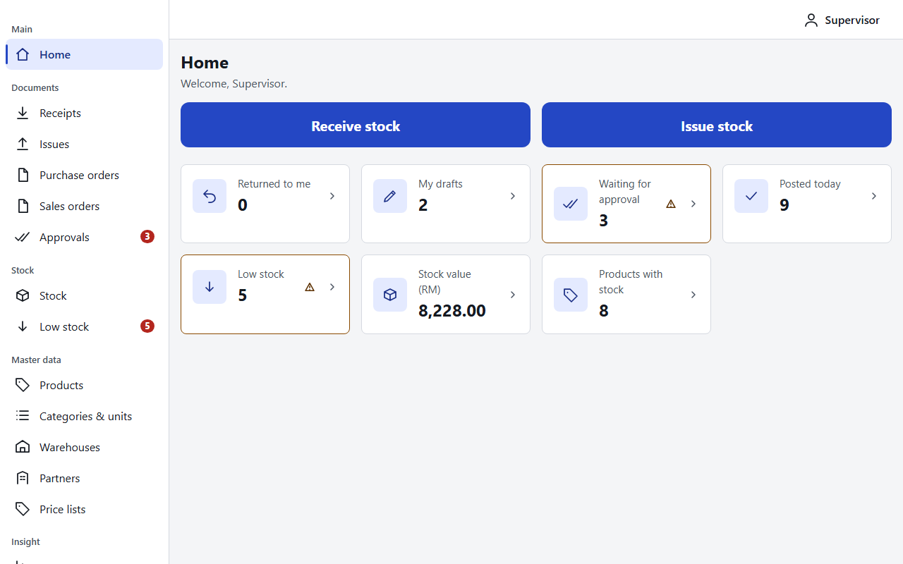 | 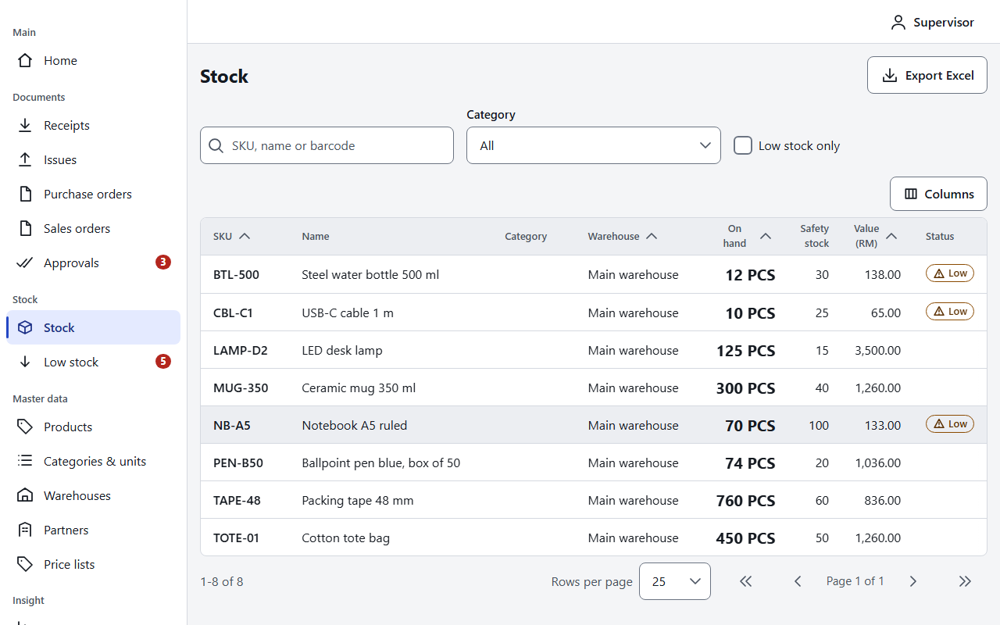 |
| Home: what needs attention for a Supervisor. | Stock enquiry with the category and low-stock filters. |
| 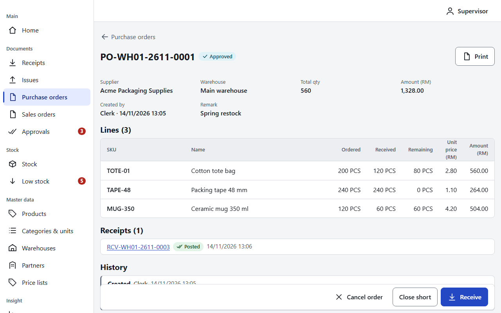 | 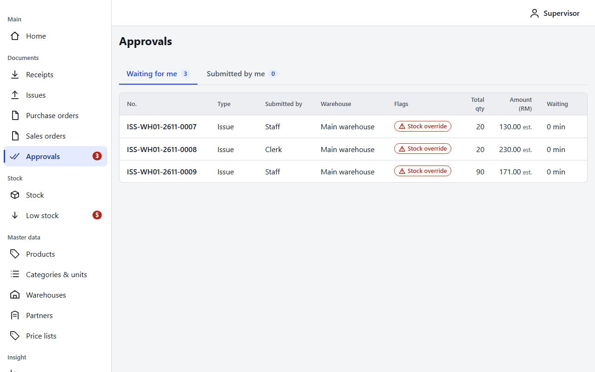 |
| A purchase order received in part: ordered, received, remaining. | Approvals inbox: issues that go below zero wait for a reviewer. |
| 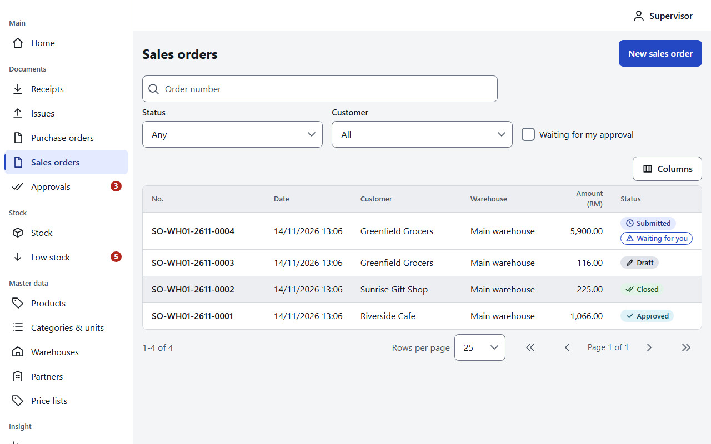 | 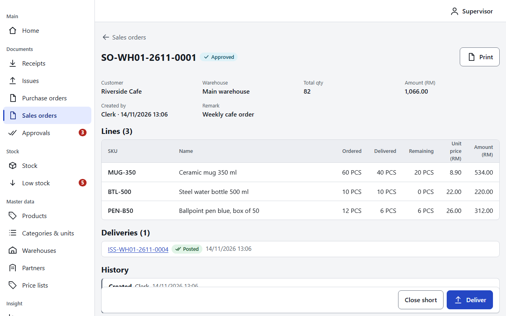 |
| Sales orders by status, with the order that waits for approval marked. | An approved sales order, delivered in part. |
| 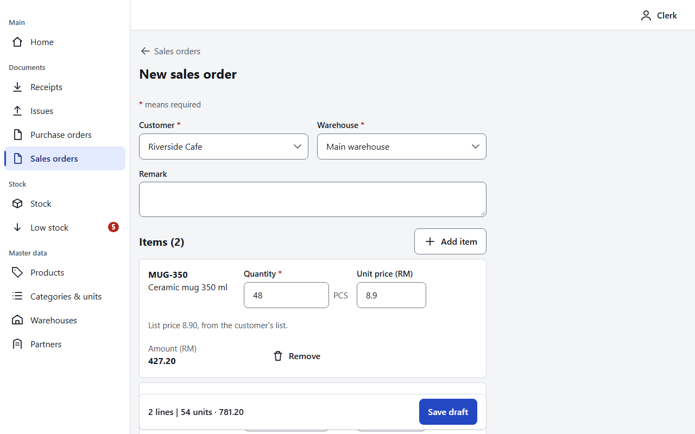 | 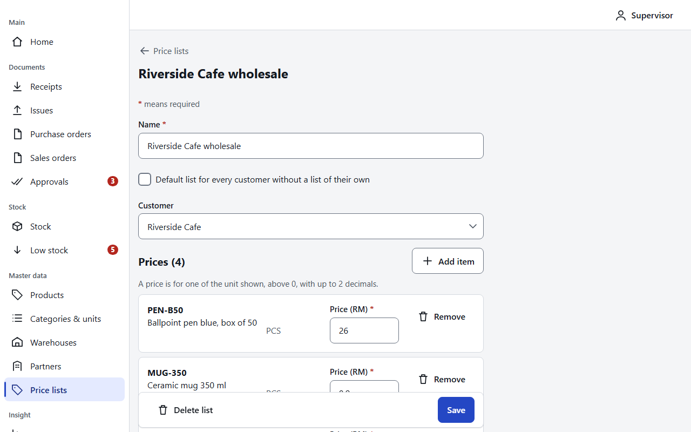 |
| New sales order: the unit price comes from the customer's price list. | A customer's price list. |
| 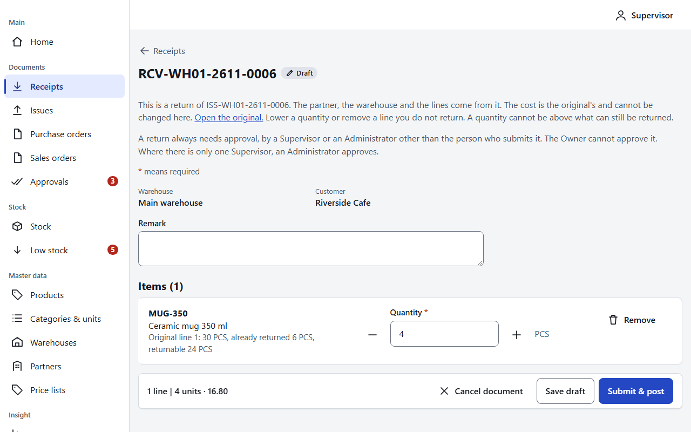 | 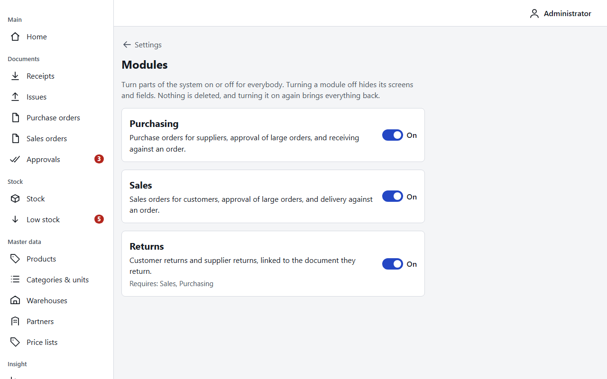 |
| A second return of a sale: the original, what was returned and what can still be returned. | Settings > Modules: purchasing, sales and returns are switches. |

On a phone (360 x 740):

| | | |
|---|---|---|
| 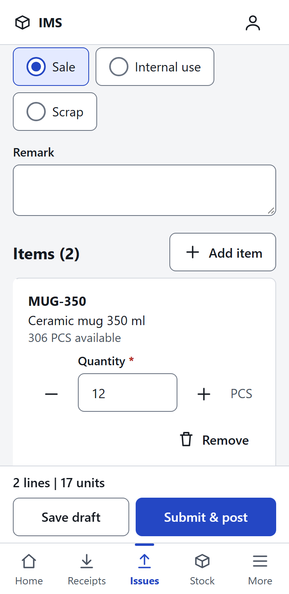 | 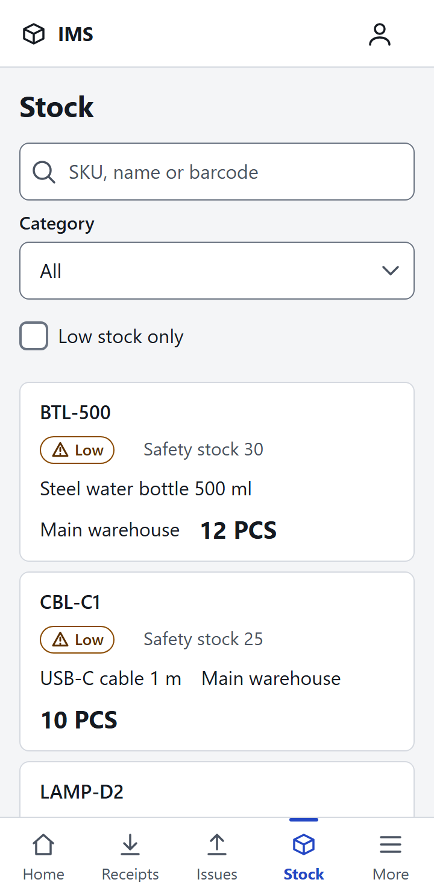 | 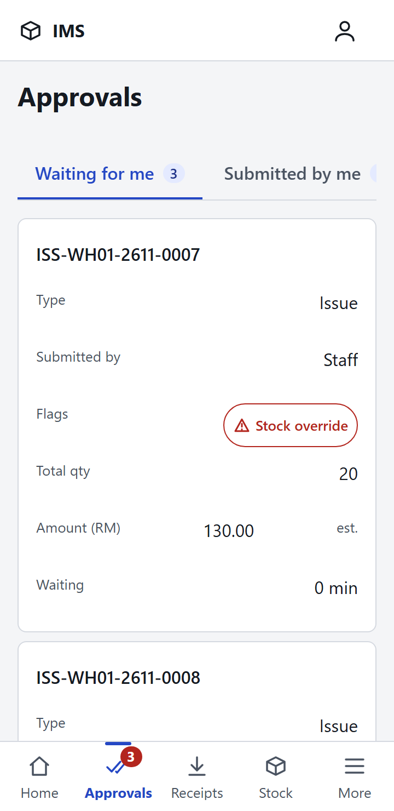 |
| Issue editor with the stock available per line. | Stock enquiry as cards. | Approvals inbox. |

## Layout

| Path | What |
|---|---|
| `src/Ims.Domain` | Data model, behaviour, business services and rules (no dependencies) |
| `src/Ims.Application` | Use cases (CQRS), specifications, validators, ports |
| `src/Ims.Infrastructure` | EF Core + migrations, repositories, JWT, Excel, seed |
| `src/Ims.Api` | REST API, auth, Swagger, logging |
| `web/` | Angular PWA |
| `tests/` | Domain, architecture, integration, smoke, load (k6) and security tests |
| `e2e/` | Playwright browser tests against the running API and web app |
| `deploy/` | Docker Compose, Caddy and backup scripts for one VM (not deployed yet) |
| `docs/` | Architecture, design, DBA and security notes, QA reports, plans, team protocol |

Architecture details: [docs/architecture/backend.md](docs/architecture/backend.md).

## Run it locally

Prerequisites: .NET 10 SDK, Node 22.22.3+ (or 24.15+), SQL Server (LocalDB works).

```bash
# 1. API (applies migrations and seeds demo data on first start)
cd src/Ims.Api
ASPNETCORE_ENVIRONMENT=Development dotnet run     # http://localhost:5109, Swagger at /swagger

# 2. Web
cd web
npm install
npm run dev                                          # http://localhost:4200
```

Sign in as one of the demo users (`admin`, `owner`, `supervisor`, `staff`, `clerk`). Development settings (LocalDB connection, demo users and their dev-only passwords) are in
`src/Ims.Api/appsettings.Development.json`. They only work against a throwaway local database.
Never reuse them elsewhere; production secrets come from environment variables (see `.env.example`).

## Test

```bash
dotnet test Ims.sln                                           # unit + architecture (+ integration with IMS_TEST_DB set)
IMS_ADMIN_PASSWORD=... IMS_DEMO_PASSWORD=... node tests/smoke/smoke.mjs   # end-to-end API flow against a running API
cd web && npm run lint && npm test                            # eslint, stylelint, jest
cd e2e && npm ci && npm run test:local                        # Playwright against a running API and web app, see e2e/README.md
```

## CI/CD (GitHub Actions)

| Workflow | When | Does |
|---|---|---|
| `ci.yml` | push to `main`, PR | API: format check, build (warnings as errors), unit + architecture + integration tests on a SQL Server container, API smoke test. Web: lint, format check, Jest, colour contrast, production build. Dependency audit |
| `pr-guard.yml` | PR | conventional titles and commits, branch names, no secrets or forbidden files, bounded PR size |
| `codeql.yml` | push to `main`, PR, weekly | CodeQL code scanning |
| `release.yml` | after a green CI run on `main`, manual | builds the API and web container images and pushes them to GitHub Container Registry |
| `deploy.yml` | manual | environment-gated deploy to the one VM over SSH (`deploy/scripts/deploy.sh`). There is no VM yet, so it stops at its first step until the secrets exist |
| `e2e.yml` | manual, weekly | the Playwright suite against the API and the production web build (never on a PR) |
| `dast.yml` | manual, weekly | OWASP ZAP scan of the API |

## Docker

```bash
cp .env.example .env   # fill in the values
docker compose up --build
```

That starts SQL Server and the API for local use. The production layout (Caddy, backups, nothing but ports 80 and 443 published) is in
[deploy/README.md](deploy/README.md).

## Team

Delivery roles (product, BA, design, architecture, QA personas, testers) are defined as agents in `.claude/agents/`;
the hand-off protocol is in `docs/team/PROTOCOL.md`.
